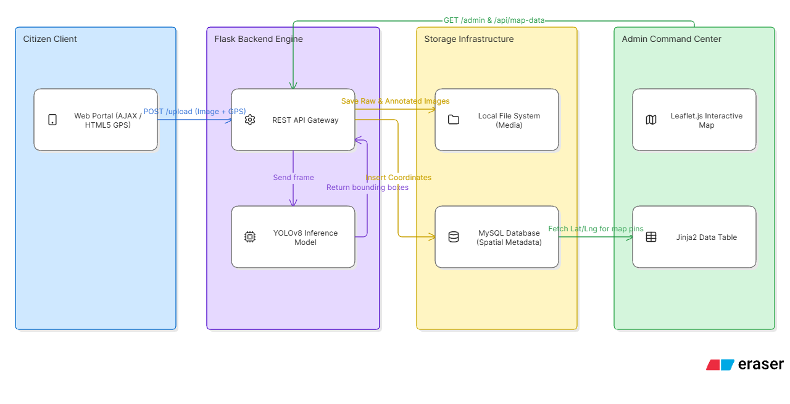

# CivicSense Pro: Automated Infrastructure Monitoring & Geospatial Telemetry

An end-to-end municipal telemetry pipeline combining edge computer vision (YOLOv8) with an asynchronous Flask backend, relational spatial logging, and an interactive dispatch dashboard.

---

## System Architecture


---

## Technical Trade-offs & Spatial Design
- **Model Selection (YOLOv8s):** Selected the Small model variant (~11.2M parameters) over the Nano variant to maintain structural boundary detection on irregular road cracks while preserving sub-second local CPU inference latency.
- **Post-Processing Filtering:** Set Non-Maximum Suppression (NMS) to `iou=0.40` and confidence threshold to `conf=0.50` to suppress redundant overlapping bounding boxes from angled citizen captures.
- **Storage Decoupling:** Binary image blobs are kept outside the database and served as static assets; MySQL stores only indexed path strings and high-precision spatial coordinates (`DECIMAL(10,8)`).

---

## API Endpoints
| Endpoint | Method | Payload / Input | Description |
| :--- | :--- | :--- | :--- |
| `/` | `GET` | None | Serves the responsive citizen reporting portal. |
| `/upload` | `POST` | `multipart/form-data` (`file`, `lat`, `lng`) | Ingests payload, executes YOLO inference, commits record to MySQL. |
| `/admin` | `GET` | None | Renders the server-side operations dashboard. |
| `/api/map-data` | `GET` | None | Serializes spatial coordinates and image paths for Leaflet.js marker rendering. |

---

## Local Setup & Installation
### Prerequisites
- Python 3.9+
- MySQL Server 8.0+

### 1. Clone & Set Up Environment
```bash
git clone https://github.com/<your-username>/CivicSensePro.git
cd CivicSensePro
pip install -r requirements.txt
```

### 2. Configure Database Schema
Execute the following inside MySQL Workbench:
```sql
CREATE DATABASE civicsense_db;
USE civicsense_db;

CREATE TABLE reports (
    id INT AUTO_INCREMENT PRIMARY KEY,
    raw_image_name VARCHAR(255) NOT NULL,
    analyzed_image_path VARCHAR(255) NOT NULL,
    latitude DECIMAL(10, 8),
    longitude DECIMAL(11, 8),
    confidence_score DECIMAL(5, 2),
    report_time TIMESTAMP DEFAULT CURRENT_TIMESTAMP
);
```

### 3. Run the Server
```bash
python app.py
```

---

## Future Improvements
If provided with increased GPU compute capabilities, the system architecture will be upgraded to process real-time RTMP video streams from municipal dashcams rather than relying on static citizen image uploads.